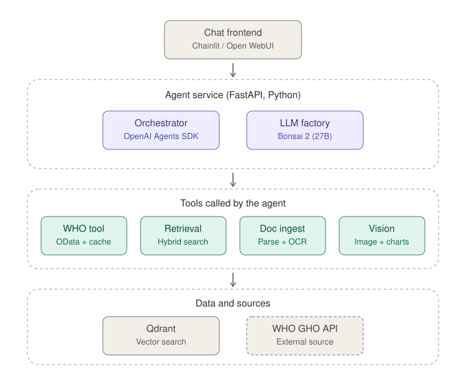

# WHO conversational agent: prototype build guide

A first prototype of a chat agent that answers health questions using the WHO data API and a small document set. It can read PDFs, scans and images.

Scope for this version: no conversation storage, no user accounts, one machine. Everything below is the minimum needed to prove the idea.

## 1. Architecture



Diagram file: [architecture.svg](architecture.svg) (keep it in the same folder as this file).

| Layer | Component | Job |
|---|---|---|
| Frontend | Chainlit (or Open WebUI) | Chat window, file upload |
| Agent service | OpenAI Agents SDK | Runs the loop: model decides, calls tools, answers. Keeps chat history in memory for the current session |
| Agent service | LLM factory | One function that returns the configured model client (Bonsai 2 now, swappable later) |
| Tools | WHO tool | Searches indicators and fetches data from the WHO GHO API |
| Tools | Retrieval | Hybrid search (dense + sparse) with reranking over ingested documents |
| Tools | Doc ingest | Parses PDF/DOCX/scans, runs OCR, chunks, embeds, stores in Qdrant |
| Tools | Vision | Reads images and charts |
| Data | Qdrant | Vector store |
| Source | WHO GHO API | External, read-only |

## 2. Stack

| Need | Library / tool |
|---|---|
| Agent loop, tools, sessions | `openai-agents` |
| Model client | `openai` (`AsyncOpenAI`) pointed at your own endpoint |
| Frontend | `chainlit` |
| WHO API calls | `httpx` |
| Document parsing + OCR | `docling` (fallbacks: `PyMuPDF`, Tesseract `deu`) |
| Embeddings | `bge-m3` via `FlagEmbedding` (dense + sparse) |
| Reranker | `bge-reranker-v2-m3` |
| Vector DB | `qdrant-client` + Qdrant container |
| Config | `pydantic-settings` |

## 3. Project layout

```
who-agent/
├── docker-compose.yml
├── .env
├── pyproject.toml
├── architecture.svg
├── src/
│   ├── app.py               # Chainlit entry point
│   ├── agent.py             # Agent definition and instructions
│   ├── llm_factory.py       # make_model()
│   └── tools/
│       ├── who.py           # search_indicators, get_indicator_data
│       ├── retrieval.py     # search_documents
│       ├── ingest.py        # ingest_file (parse, OCR, chunk, embed, upsert)
│       └── vision.py        # describe_image
├── data/
│   └── uploads/             # local files for now
└── eval/
    └── questions.jsonl      # test questions with expected tool and value
```

## 4. Local setup

`docker-compose.yml` starts Qdrant and the agent. The LLM runs outside Compose for now, because the runtime for Bonsai 2 is still to be confirmed (see section 7).

```yaml
services:
  qdrant:
    image: qdrant/qdrant
    ports: ["6333:6333"]
    volumes: ["./qdrant_data:/qdrant/storage"]

  agent:
    build: .
    env_file: .env
    ports: ["8000:8000"]
    depends_on: [qdrant]
    extra_hosts: ["host.docker.internal:host-gateway"]
```

`.env`:

```
LLM_BASE_URL=http://host.docker.internal:8080/v1
LLM_MODEL=<model name as served>
LLM_API_KEY=none
QDRANT_URL=http://qdrant:6333
```

## 5. Core code

### LLM factory

```python
# src/llm_factory.py
import os
from openai import AsyncOpenAI
from agents import OpenAIChatCompletionsModel, set_tracing_disabled

set_tracing_disabled(True)  # built-in tracing sends data to OpenAI's platform

def make_model() -> OpenAIChatCompletionsModel:
    client = AsyncOpenAI(
        base_url=os.environ["LLM_BASE_URL"],
        api_key=os.getenv("LLM_API_KEY", "none"),
    )
    return OpenAIChatCompletionsModel(model=os.environ["LLM_MODEL"], openai_client=client)
```

Local servers usually speak Chat Completions, not the Responses API, which is why the model is created explicitly.

### WHO tool

The GHO OData API lives at `https://ghoapi.azureedge.net/api`. `/Indicator` lists indicators and supports `$filter`. `/<IndicatorCode>` (for example `WHOSIS_000001`) returns the data. Rows carry `SpatialDim` (country code), `TimeDim` (year) and `NumericValue`.

```python
# src/tools/who.py
import httpx
from agents import function_tool

BASE = "https://ghoapi.azureedge.net/api"

@function_tool
async def search_indicators(keyword: str) -> list[dict]:
    """Find WHO indicators whose name contains the keyword (English)."""
    kw = keyword.lower().replace("'", "''")
    params = {"$filter": f"contains(tolower(IndicatorName),'{kw}')"}
    async with httpx.AsyncClient(timeout=30) as c:
        r = await c.get(f"{BASE}/Indicator", params=params)
        r.raise_for_status()
    return [{"code": i["IndicatorCode"], "name": i["IndicatorName"]}
            for i in r.json()["value"][:20]]

@function_tool
async def get_indicator_data(
    indicator_code: str,
    country_iso3: str | None = None,
    year: int | None = None,
) -> list[dict]:
    """Fetch values for one WHO indicator, optionally for one country and year."""
    filters = []
    if country_iso3:
        filters.append(f"SpatialDim eq '{country_iso3.upper()}'")
    if year:
        filters.append(f"TimeDim eq {year}")
    params = {"$orderby": "TimeDim desc", "$top": "50"}
    if filters:
        params["$filter"] = " and ".join(filters)
    async with httpx.AsyncClient(timeout=30) as c:
        r = await c.get(f"{BASE}/{indicator_code}", params=params)
        r.raise_for_status()
    return [{"country": v.get("SpatialDim"), "year": v.get("TimeDim"),
             "sex": v.get("Dim1"), "value": v.get("NumericValue"),
             "display": v.get("Value")} for v in r.json()["value"]]
```

Add a small cache (a dict with a time limit is enough) once you see repeated calls.

### Agent

```python
# src/agent.py
from agents import Agent
from llm_factory import make_model
from tools.who import search_indicators, get_indicator_data

INSTRUCTIONS = """You are a public-health assistant.
- For statistics, use the WHO tools. Never state a number you did not get from a tool.
- Always name the indicator code, country and year behind a number.
- If no data is found, say so."""

agent = Agent(
    name="WHO assistant",
    instructions=INSTRUCTIONS,
    model=make_model(),
    tools=[search_indicators, get_indicator_data],
)
```

### Chat entry point

```python
# src/app.py
import chainlit as cl
from agents import Runner, SQLiteSession
from agent import agent

@cl.on_chat_start
async def start():
    # no db path = in-memory session, lost when the chat ends
    cl.user_session.set("session", SQLiteSession(cl.user_session.get("id")))

@cl.on_message
async def on_message(msg: cl.Message):
    session = cl.user_session.get("session")
    result = await Runner.run(agent, msg.content, session=session)
    await cl.Message(content=result.final_output).send()
```

Chainlit runs its own server, so for the first version the agent runs in the same process. Put FastAPI in front only when you need a separate API.

## 6. Build order

Each step has a clear "done when" so you know when to move on.

1. **Model connection.** Start the LLM runtime, create `make_model()`, send one plain question.
   Done when: the model answers in German and English.
2. **WHO tool.** Implement `search_indicators` and `get_indicator_data`, add them to the agent.
   Done when: "What was life expectancy in Germany in 2019?" returns a value with indicator code, country and year, and the number matches the API response.
3. **Chat UI.** Add Chainlit with an in-memory session.
   Done when: a follow-up question ("and for France?") works without repeating context.
4. **Ingest + retrieval.** Parse a few PDFs with Docling (OCR on), chunk, embed with bge-m3, store in Qdrant. Add `search_documents` with hybrid search and reranking, and make answers cite document and page.
   Done when: a question about a PDF returns the right passage with its source.
5. **Vision.** Check whether Bonsai 2 accepts images in your runtime. If yes, `describe_image` calls the same endpoint with the image attached. If not, serve a separate vision model and point the tool at it.
   Done when: the agent reads a chart or a scanned page you upload.
6. **Evaluation.** Write 20 to 30 questions (German and English) in `eval/questions.jsonl` with the expected tool and expected value. Run them in a loop and count passes.
   Done when: you have a pass rate you can compare across models.

## 7. Risks and open decisions

- **Bonsai 2 runtime.** It is a 1-bit/ternary model family. Confirm on the model card which runtime serves it and whether that runtime exposes an OpenAI-compatible endpoint with tool calling. If it doesn't work well, change `LLM_BASE_URL` and `LLM_MODEL`; nothing else changes.
- **Tool-calling quality.** Run step 6 early. If the model picks wrong tools or invents numbers, compare with a standard-quantized model of similar size before building more.
- **Tracing.** Built-in tracing is disabled so no data goes to an external platform. Add a self-hosted tracer (for example Langfuse) when you need to debug runs.
- **WHO indicator search.** `search_indicators` matches English indicator names. For German questions, the model must translate the keyword first; say so in the instructions or test it.
- **Persistence.** Sessions are in memory only. If you later need history, switch the session class to a database-backed one and keep audit logs separate.
- **Sessions and crashes.** A crash mid-run loses that run. Fine for a prototype.

## 8. Not in this version

Conversation storage, long-term memory, user login, object storage for uploads, multi-agent handoffs, Kubernetes.
